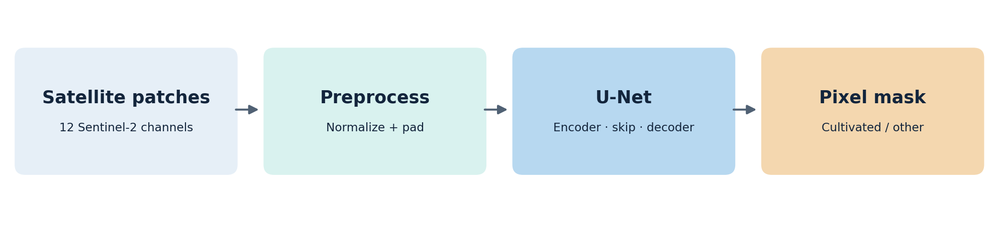
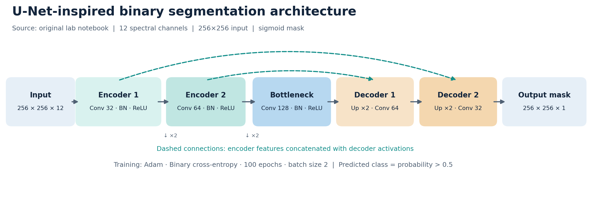
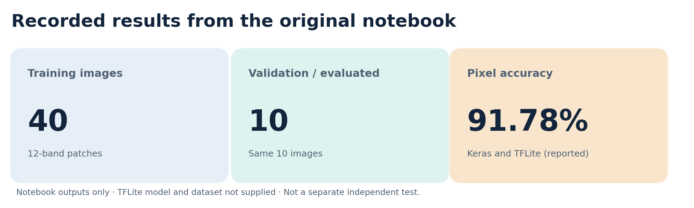
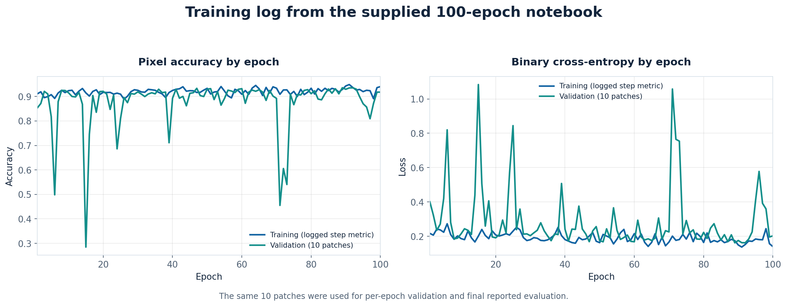

# Sentinel-2 Satellite Segmentation | U-Net & TFLite

**Binary cultivated-land segmentation from multispectral Sentinel-2 image patches using a U-Net-inspired convolutional neural network, with TensorFlow Lite model conversion and segmentation evaluation.**

**Areas:** Computer Vision · Deep Learning · Semantic Segmentation · Remote Sensing · Model Optimization  
**Technologies:** Python · TensorFlow / Keras · NumPy · Matplotlib · TensorFlow Lite  
**Context:** Academic image-segmentation and neural-network-quantization lab



## Overview

Unlike image classification, which assigns one label to an entire image, **semantic segmentation predicts a class for every pixel**. This project explores binary segmentation of **cultivated land** using satellite imagery with **12 spectral channels** per patch.

The original notebook implements a two-level U-Net-inspired encoder–decoder with skip connections, trains it on 40 image patches, evaluates its pixel predictions on 10 held-out patches used during validation, and converts the Keras network to TensorFlow Lite. A companion pipeline organizes the workflow into reusable components and adds **foreground Intersection over Union (IoU), Dice score, precision, recall, and TFLite comparison**.

## Model architecture



- **Input:** Sentinel-2 patches padded to `256 × 256 × 12`.
- **Encoder:** convolution, batch normalization and ReLU blocks at **32** and **64** filters, with stride-2 downsampling.
- **Bottleneck:** **128**-filter convolution block.
- **Decoder:** two upsampling stages, with skip-feature concatenation and **64** then **32** filters.
- **Output:** one-channel sigmoid probability mask, thresholded at **0.5**.

## Results in the original lab

| Metric / setting | Recorded value |
|---|---:|
| Training patches | **40** |
| Validation / evaluated patches | **10** |
| Epochs / batch size | **100 / 2** |
| Keras pixel accuracy | **91.78%** |
| Manual thresholded pixel accuracy | **91.78%** |
| TFLite pixel accuracy | **91.78%** |





These figures reproduce **results recorded in the supplied notebook**, not independently rerun benchmarks. The original 10-image evaluation partition was **also used for validation during training**. Original pixel accuracy includes the padded borders, and the dataset source and model files were not provided. The reported TFLite accuracy matches Keras, but the saved output alone does not verify the quantized tensor types. The companion pipeline explicitly inspects them. Further details are in [experiment notes](docs/experiment_notes.md).

## Repository contents

```text
Sentinel2-UNet-Segmentation/
├── notebooks/
│   ├── original_lab3.ipynb               # Original lab notebook (unchanged)
│   └── reproducible_walkthrough.ipynb    # New structured reproduction notebook
├── src/sentinel_unet/
│   ├── data.py                           # Dataset loading and splitting
│   ├── model.py                          # Original U-Net-inspired architecture
│   ├── metrics.py                        # Pixel accuracy, IoU, Dice, precision, recall
│   ├── tflite_utils.py                   # Conversion, inference, type inspection
│   └── visualization.py                  # Prediction and training plots
├── scripts/train_and_evaluate.py         # End-to-end CLI pipeline
├── tests/test_data_metrics.py            # Data and metric unit tests
├── data/README.md                        # Required data format and setup
├── docs/images/                          # Architecture and original-run figures
├── docs/original_training_log.csv        # Parsed values from notebook output
├── docs/experiment_notes.md              # Protocol and interpretation
└── requirements.txt
```

## Run the project

**Python 3.10+** is recommended. A GPU-enabled environment is useful for training.

```bash
python -m venv .venv
# Windows: .venv\Scripts\activate
# macOS/Linux: source .venv/bin/activate
python -m pip install -r requirements.txt
```

Place the **course’s original `sentinel2.npz`** at `data/sentinel2.npz`. It must contain arrays `X` (12-band images) and `Y` (binary masks). The archive was **not included** in the uploaded notebook, so it cannot be redistributed here. See [dataset setup](data/README.md) for the expected structure.

### Recommended: separate train / validation / evaluation

```bash
python scripts/train_and_evaluate.py --data data/sentinel2.npz --split-mode three-way --epochs 100
```

With the original 50 patches, this uses **35 training, 5 validation, and 10 final evaluation** patches. This is a cleaner evaluation protocol but **will not reproduce the reported 91.78% exactly**, because it changes the training split. Geographic independence is still unverified.

### Reproduce the original split

```bash
python scripts/train_and_evaluate.py --data data/sentinel2.npz --split-mode original --epochs 100
```

Uses the notebook’s 40 training / 10 shared validation-and-evaluation partition; use for educational comparison only.

The script saves trained Keras and TFLite models, raw and unpadded evaluation metrics, learning curves and real prediction examples to `outputs/`. Training requires the original dataset and a compatible TensorFlow installation. The original notebook’s reported results have **not** been rerun without that data.

### Unit tests

```bash
python -m unittest discover -s tests -v
```

## Evaluation and visualization

The companion evaluation reports:

- **Pixel accuracy:** fraction of correctly classified pixels.
- **Foreground IoU:** overlap between predicted and actual cultivated-land regions.
- **Dice score:** agreement of predicted and actual foreground masks.
- **Precision and recall:** false-positive and false-negative behavior for cultivated land.
- **TFLite model details:** artifact size, tensor data types, and segmentation quality after conversion.

The script excludes padding when reporting the principal segmentation metrics. The `segmentation_examples.png` output is **generated from real predictions only after training**; the repository does not substitute synthetic satellite examples for missing data.

## Scope and next steps

Potential extensions include region-disjoint testing, multi-seed evaluation, class-imbalance analysis, comparisons against a simpler baseline, and verification of fully integer quantization.

